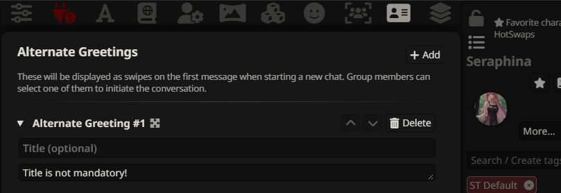
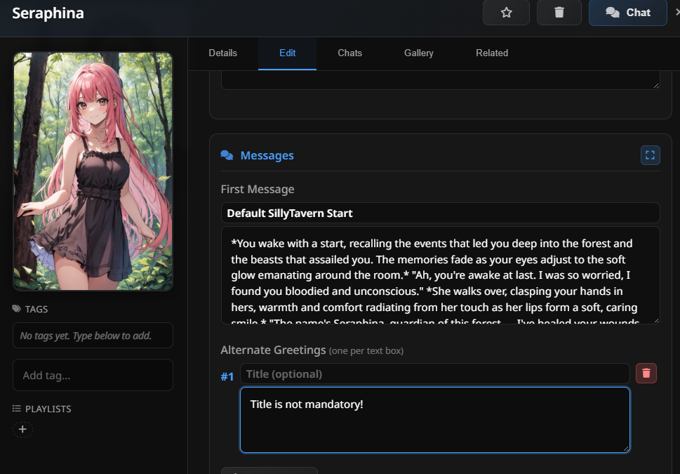
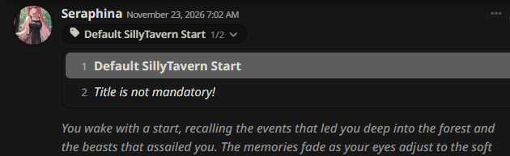

# Greeting Titles

Gives alternative greeting messages a title and easy-interface to select ones. paris with [CharacterLibrary](https://github.com/Sillyanonymous/SillyTavern-CharacterLibrary) (not required). 

"Why did you create this (or rather get claude to do it)?" - Because I found Greeting Tools to be very clunky, unintuitive and generally not a good experience to use, it also does not pair with CharacterLibrary.

---

## Features
- Native-feel of greeting-titles, both in Character Library and not.


### Title greetings in ST's character editor

A title field above the first message, and one for each greeting in the **Alt. Greetings** popup. The title also shows in the greeting's header. Titles save as you type and follow their greeting when you move or delete greetings.



### Title greetings in CharacterLibrary

If you use CharacterLibrary, the same titles show up there:
- **Edit tab:** title fields for the first message and each alternate greeting. They lock and unlock with CL's edit lock and appear in CL's save confirmation.
- **Details tab and fullscreen greeting viewer:** greetings show as `#1 · Beach Day` instead of `#1`.

CharacterLibrary's own files are **not modified**. Greeting Titles hooks into it at runtime, so updating CL doesn't break anything.



### See which greeting you're on

The chat's opening message shows the current greeting's title and its position.


### Pick a greeting by name

Before the first reply, click the title to get a list of every greeting by name and jump straight to the one you want. No swiping through them one by one.



---

## Installation

In SillyTavern: **Extensions → Install extension**, and paste:

```
https://github.com/lalzy/ST-GreetingTitles
```

Or manually: put the folder in `SillyTavern/data/default-user/extensions/` and reload SillyTavern.

---

## Options

**Extensions → Greeting Titles**

| Option | Default | What it does |
|---|---|---|
| Title fields in the character editor | On | Title fields for the first message and in the Alt. Greetings popup |
| Show greeting title in chat | On | Title bar on the chat's opening message |
| Click the title to pick a greeting | On | Click the title bar to open the greeting list (only before the first reply) |
| Also for characters without titles | Off | Shows the bar and picker for every character. Untitled greetings show as "Greeting #n" with a preview of the text |
| CharacterLibrary integration | On | Title fields and labels inside CharacterLibrary (applies the next time CL is opened) |

---

## Good to know

- **Titles are stored in the character card** (`data.extensions.greeting_titles`), so they're saved with the card and exported with it.
- **Titles follow their greeting.** Each title is linked to its greeting's text, so reordering, deleting or adding greetings, in ST, CharacterLibrary or another editor, keeps the right title on the right greeting. Editing a greeting's text keeps its title too.
- **Coming from Greeting Tools?** Titles you made with it are read in automatically. They're converted to Greeting Titles' own format the next time you change a title in ST, or save that character in CharacterLibrary. Disable Greeting Tools so the two don't both act on the same greetings.
- **Picking a greeting only works before the first reply.** That's SillyTavern's rule: the opening message can only be swiped while it's the only message in the chat.
- **Open CharacterLibrary from ST's button.** If you open CL by typing its address directly, or leave a CL tab open while ST reloads, the title fields won't appear in CL until you reopen it from ST.
- **Group chats** aren't supported. The title bar only shows in one-on-one chats.
- **New characters:** the title fields are hidden while you're creating a character, because there's no card to save titles to yet. Save the character first, then add titles.

---

## Compatibility

Tested with SillyTavern 1.19.1 (release) and CharacterLibrary 7.2.4.
